## 项目

| 项目 | 研究方向 | 已实现内容 |
|---|---|---|
| [diurnix](https://github.com/jialuncai/diurnix) | Personal Agent 运行时框架 × 生活应用 | 类型化事件基座与校验和 JSONL、合成 persona 数据工厂（植入意图/冲突/异常/连续性真值）、工具注册表与策略门控执行器（幂等键/两阶段提交/崩溃恢复）、声明式策略引擎（allow-deny-ask、PII 双向脱敏、不可变决策日志）、预算化感知-计划-行动-观察循环、意图路由（NumPy 打分器 + 可选 torch MLP）、审批流与升级链、字节确定性会话录制/重放、分级记忆（保留策略+隐私层级）、四个生活应用（邮件日程分诊 · GTD 任务规划 · 台账异常检测 · 习惯 streak 代数）、bench 基准与确定性 SVG/HTML 日报、完整 CLI |

528 次提交（2025.01 — 2026.10）· 56 个源码模块 · 4 个可运行离线示例 · 每次提交都经过构建、测试与格式检查。所有测量数字来自带植入真值的确定性合成 persona 数据：无真实 LLM 调用、无预训练权重、全离线可复现。

## 技术栈

## 活动

<picture>
  <source media="(prefers-color-scheme: dark)" srcset="https://raw.githubusercontent.com/jialuncai/jialuncai/output/github-snake-dark.svg" />
  <source media="(prefers-color-scheme: light)" srcset="https://raw.githubusercontent.com/jialuncai/jialuncai/output/github-snake.svg" />
  
</picture>

## 当前关注

- 策略引擎的可证明性质：拒绝动作在任意随机序列下永不执行、脱敏双向不泄漏植入 PII。
- 会话重放的字节级确定性与崩溃恢复：检查点/恢复与直跑产物一致。
- 个人数据的合成评测方法学：植入真值上的分诊精度、异常 precision/recall 与预算遵从的诚实校准。
